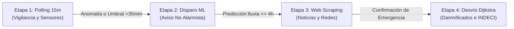

# Kyberna IA — Orquestador Predictivo ML y Desvíos Logísticos (Pipeline 4 Etapas + React)

**Kyberna IA** es un sistema inteligente full-stack diseñado bajo una **Arquitectura Limpia de N-Capas** para anticipar catástrofes hidrometeorológicas con **Machine Learning**, auditar información de campo en tiempo real mediante **Web Scraping** y redirigir convoyes de ayuda humanitaria de **INDECI** por carreteras reales durante el **Fenómeno del Niño** en el Perú (caso georreferenciado: **Cuenca del Río Moche, La Libertad**).

---

## 1. Pipeline Autónomo de 4 Etapas

El sistema opera de forma secuencial y gobernada a través de 4 fases operativas:



1. **Etapa 1 · Vigilancia Rutinaria (Polling cada 15 min)**:
   - Polling automatizado a APIs meteorológicas (SENAMHI, NASA EONET, Sentinel-1 SAR) con contador regresivo en vivo (`15:00`).
   - Estado del corredor: **Normal (Semáforo Verde)**, cero alarmas, carreteras expeditas.
2. **Etapa 2 · Alerta Preventiva (Disparo Predictivo ML)**:
   - Al detectarse convergencia de factores de riesgo (lluvia acumulada, caudal, saturación del suelo, anomalía Niño 1+2), se activa el **Modelo Predictivo ML**.
   - Emite un **aviso informativo no alarmista** a la ciudadanía y transportistas vía Telegram y WhatsApp Mock, promoviendo la calma y precauciones básicas sin generar pánico.
3. **Etapa 3 · Web Scraping en Vivo (Prensa Regional y Redes Sociales)**:
   - Si la predicción arroja lluvias intensas o impacto inminente en **≤ 4 horas**, se activa el módulo de **Web Scraping** (`data/web_scraping_service.py`).
   - Rastrea portales oficiales regionales (*RPP Noticias La Libertad, Diario La Industria de Trujillo, Diario Correo Trujillo, Radio Costa Norte*) y redes sociales (*X/Twitter, WhatsApp Comunitario*).
   - Clasifica hallazgos en: **Calles Inundadas**, **Estructuras en Riesgo (Adobe)**, **Heridos / Familias Aisladas** y **Vías Bloqueadas**.
4. **Etapa 4 · Acción Humanitaria y Desvío Vial Dijkstra (Alerta Roja)**:
   - Cruza la telemetría, el pronóstico ML y los reportes de campo para calcular:
     - Población damnificada aproximada y familias afectadas.
     - Suministros vitales estándar INDECI 72h (Kits de alimentos de 18kg, litros de agua segura, carpas, frazadas y botiquines).
     - Flota logística requerida (camiones de 10 TM y tonelaje métrico total).
     - **¿Qué es recomendable hacer?**: Plan de respuesta con recomendaciones tácticas directas para Ciudadanos, Transportistas de Carga y Brigadas INDECI.
   - Activa el semáforo en **Rojo**, declara el Puente Río Moche intransitable y recalcula la **Ruta Segura de Desvío** por carreteras reales (**PE-10A Laredo**) mediante el algoritmo de **Dijkstra**.
   - Despacha la orden operativa crítica a convoyes de INDECI.

---

## 2. Estructura de Carpetas y Archivos (Arquitectura N-Capas)

```text
kyberna ia/
├── main.py                              # Punto de entrada principal (FastAPI o modo --cli)
├── verify_kyberna_pipeline.py           # Suite de auditoría (AST cero print() + validación 4 etapas)
├── requirements.txt                     # Dependencias (FastAPI, Uvicorn, NumPy, SciPy, Requests)
├── .env.example                         # Plantilla para TELEGRAM_BOT_TOKEN y TELEGRAM_CHAT_ID
├── README.md                            # Documentación integral del sistema
├── models/                              # Contratos transversales tipados (DTOs inmutables)
│   ├── __init__.py
│   └── schemas.py                       # PipelineStage, WebScrapingAuditSummary, TacticalRecommendation
├── utils/                               # Trazabilidad técnica
│   ├── __init__.py
│   └── logger_config.py                 # Logging estructurado (INFO/WARNING/ERROR, cero print())
├── data/                                # CAPA 1: DATOS (Histórico ML, Mocks, Web Scraping y OSRM)
│   ├── __init__.py
│   ├── historical_fen_dataset.py        # Dataset histórico vectorizado FEN (1998-2026) para ML
│   ├── mock_sources.py                  # Mocks SENAMHI (>55mm), NASA EONET, Sentinel-1 y Zonas Censales
│   ├── web_scraping_service.py          # Extracción y categorización de noticias regionales y redes
│   └── osrm_road_geometries.json        # Polilíneas exactas sobre carreteras reales OpenStreetMap/OSRM
├── logic/                               # CAPA 2: LÓGICA DE NEGOCIO Y MACHINE LEARNING
│   ├── __init__.py
│   ├── ml_catastrophe_predictor.py      # Modelo ML supervisado (Probabilidad % + Ventana de impacto)
│   ├── huaico_agent.py                  # Agente Huaicos: evalúa lluvia (>50mm), caudal y radar SAR
│   ├── nlp_engine.py                    # Filtro NLP: densidad de reportes ciudadanos y anti-fake news
│   ├── humanitarian_estimator.py        # Estimador de Damnificados, Suministros y Recomendaciones Tácticas
│   ├── route_calculator.py              # Motor de Grafos (Dijkstra): ruta bloqueada y desvío seguro [lat, lon]
│   └── orchestrator.py                  # Orquestador del Pipeline de 4 Etapas
├── notifications/                       # CAPA 3: NOTIFICACIONES MULTICANAL
│   ├── __init__.py
│   ├── telegram_service.py              # Envío HTTP REAL por API de Telegram (No-Alarmista vs Crítico)
│   └── whatsapp_service.py              # Mock de WhatsApp: log operativo en consola + JSON de éxito ($0 costo)
├── presentation/                        # Adaptador CLI
│   ├── __init__.py
│   └── whatsapp_notifier.py             # Salida por consola gobernada por logging
├── api/                                 # CAPA 4: EXPOSICIÓN REST Y SERVIDOR SPA
│   ├── __init__.py
│   └── routes.py                        # Endpoints FastAPI (/surveillance, /simulate, /stage, /notify)
└── frontend/                            # CAPA 5: CENTRO DE MANDO EN REACT 19 + LEAFLET.JS
    ├── package.json                     # Configuración de React 19, Vite y Leaflet
    ├── vite.config.js                   # Bundler y proxy hacia FastAPI
    ├── dist/                            # Bundle de producción compilado servido por FastAPI
    └── src/
        ├── App.jsx                      # Estado reactivo global, selector de 4 etapas y accesibilidad
        ├── styles/dashboard.css         # CSS moderno (Pipeline ribbon, tactical grid, @starting-style)
        └── components/
            ├── TopCommandBar.jsx        # Stepper de 4 Etapas con contador de polling 15m en vivo
            ├── InteractivePeruMap.jsx   # Mapa Leaflet OSRM + Damnificados y "¿Qué es recomendable hacer?"
            ├── InteractiveTabsPanel.jsx # Pestañas: NLP, Web Scraping Noticias, Alertas y Métricas ML
            ├── SurveillanceMetricsPanel.jsx # Sensores SENAMHI, Predicción ML y Slider interactivo
            └── TelegramConfigDialog.jsx # Modal nativo <dialog> para vincular Bot de Telegram en vivo
```

---

## 3. Ejecución y Verificación Local

### Iniciar Servidor Completo (FastAPI + React):
```powershell
.\.venv\Scripts\python.exe main.py
```
Abre en tu navegador: **`http://127.0.0.1:8000`**

### Ejecutar Suite de Auditoría y Verificación:
```powershell
.\.venv\Scripts\python.exe verify_kyberna_pipeline.py
```

---

## 4. Estándares de Ingeniería y Clean Code Cumplidos
- **Separación N-Capas Estricta**: Cada capa es modular y respeta el principio de responsabilidad única (SRP).
- **PEP 8 y Tipado Estático**: Todas las funciones poseen type hints explícitos (`-> dict[str, Any]`, `pd.DataFrame`).
- **Prohibición de `print()`**: Cero uso de `print()` en scripts productivos; 100% trazabilidad mediante el módulo estándar `logging` de Python.
- **Eficiencia Vectorizada**: Cálculos con NumPy y Pandas vectorizados sin bucles fila por fila (`iterrows()` prohibido).
- **Punto de Entrada Seguro**: Todo script encapsulado bajo `if __name__ == "__main__":`.
